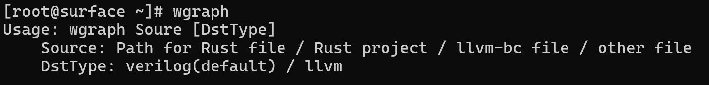

# wGraph（握图）

> Hardware-Software Co-Design toolchain.

A compiler capable of converting different languages or instruction sets.

## 1. HLS(High Level Synthesis)

Convert LLVM(C/C++/Rust) to Verilog

#### Examples

- AES128
- MNIST Training, build with [wnum](https://github.com/LonlyWinter/wnum)
- Qwen3 Interface, build with [wnum](https://github.com/LonlyWinter/wnum) and [wopt](https://github.com/LonlyWinter/wopt)
- AV1 Decoder, [coding ...](https://github.com/LonlyWinter/wav1d)

## 2. LLVM-Infra

LLVM Compiler Infrastructure in Rust

## 3. wopt

[GitHub](https://github.com/LonlyWinter/wopt)

A Solver in Rust

## 4. TODO

- Gate-Level Netlist
- GDSII

## Author

winter <winter_lonely@foxmail.com>
